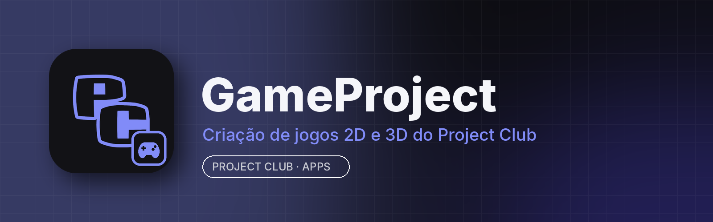

<p align="center"></p>

# GameProject

**GameProject** é o app de criação de jogos do **Project Club**: crie jogos 2D e 3D com um editor completo (cenas, física, animação, interface, áudio e scripts), teste com um clique e exporte para várias plataformas. Tem a cara do Project Club e vem integrado à aba **Apps** do app para computador.

É baseado no **[Godot Engine](https://godotengine.org)**, de código aberto sob a licença MIT. Todos os recursos do Godot continuam aqui; o GameProject troca o nome, o ícone e o tema e faz a integração com o Project Club.

## Principais recursos

- Editor visual de cenas 2D e 3D com nós, cenas reutilizáveis e herança de cenas
- GDScript (parecido com Python), C++ via GDExtension e editor de scripts com autocompletar e depurador
- Física 2D e 3D, navegação, partículas, iluminação global e pós-processamento
- Editor de animações, máquina de estados, tilemaps e interface (UI) com temas
- Shaders visuais e em código, materiais PBR e importação de modelos (glTF, FBX, OBJ)
- Áudio com barramentos, efeitos e áudio posicional
- Rodar o jogo dentro do editor (aba Jogo) e exportar para Windows, Linux, Android, Web e outros
- Tema do Project Club, interface em português e atualizações pela aba Apps

## Instalar

Pelo **Project Club** (recomendado): aba **Apps → GameProject → Instalar**. As atualizações chegam por lá.

Manual: baixe em [Releases](../../releases/latest):
- **Windows 10/11 (64 bits):** `GameProject-<versão>-win.zip` → extraia e abra `GameProject.exe`
- **Linux (x86_64):** `GameProject.AppImage` → `chmod +x GameProject.AppImage && ./GameProject.AppImage`

## Requisitos

| | Mínimo | Recomendado |
|---|---|---|
| Sistema | Windows 10 64 bits / Linux x86_64 (glibc 2.35+, Ubuntu 22.04) | Windows 11 / Ubuntu 24.04 |
| CPU | 2 núcleos com SSE4.2 | 4 núcleos ou mais |
| RAM | 4 GB (o editor usa ~300 MB–1,5 GB conforme o projeto) | 8 GB ou mais |
| GPU | OpenGL 3.3 (modo Compatibilidade) | Vulkan 1.0 / Direct3D 12 (modos Forward+ e Mobile) |
| Disco | ~150 MB para o app + espaço dos projetos | SSD |

## Compilar

Python 3 e SCons (veja a [documentação do Godot](https://docs.godotengine.org/en/latest/engine_details/development/compiling/index.html)):

```bash
git clone https://github.com/RiqueBitt/GameProject
cd GameProject
scons platform=linuxbsd target=editor   # no Windows: platform=windows
```

Para gerar os pacotes publicados no Project Club, rode o workflow **Build GameProject release** (Actions → *Run workflow*, informando a versão). Ele compila Windows e Linux e publica a release `vX.Y.Z` **neste repositório**.

## Créditos e licença

GameProject é uma versão modificada do **Godot Engine**, © 2014-present Godot Engine contributors e © 2007-2014 Juan Linietsky, Ariel Manzur, distribuída sob a **licença MIT** (veja [LICENSE.txt](LICENSE.txt)). Componentes de terceiros e suas licenças estão em [COPYRIGHT.txt](COPYRIGHT.txt) e em `thirdparty/`. O GameProject não é afiliado à Godot Foundation; Godot e o logotipo do Godot são marcas da Godot Foundation. O README original está em [docs/README-Godot-original.md](docs/README-Godot-original.md).
